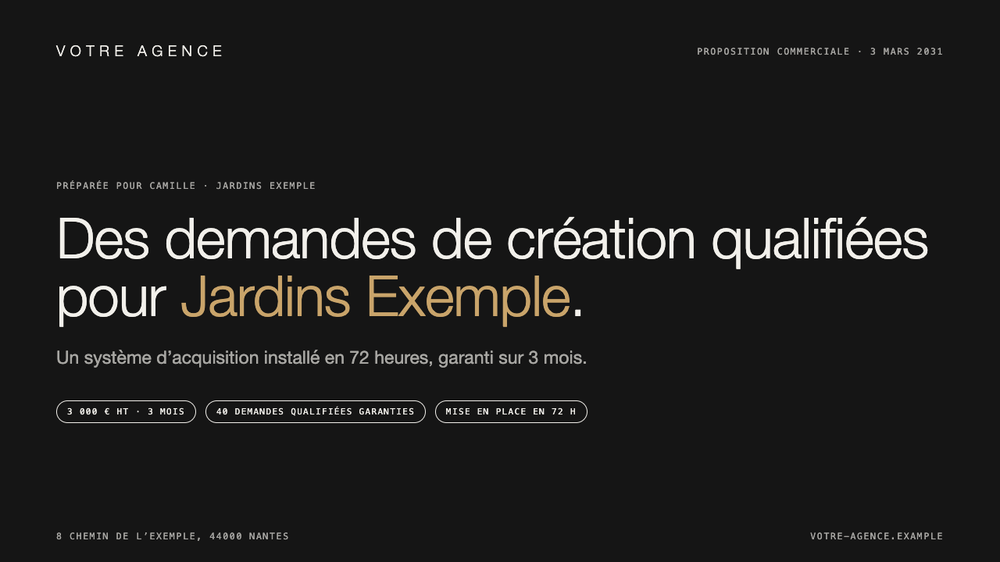
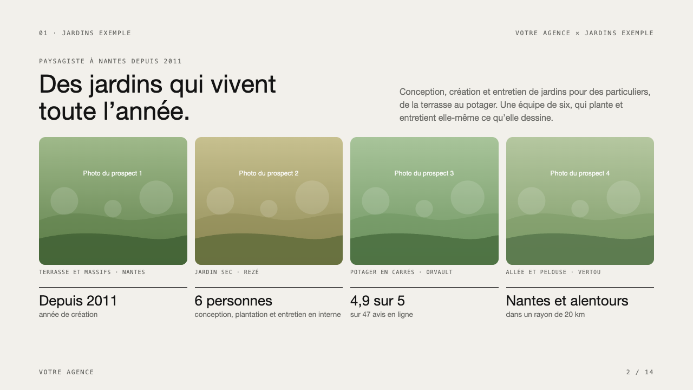

<div align="center">


# Autonomous Sales Proposal

### Votre proposition commerciale, prête le soir du premier rendez-vous.

Un PDF de 14 diapos qui montre au prospect qu'on l'a compris,<br>
prouve le résultat avant de parler prix, et donne l'offre au prix plein,<br>
plus le mail qui porte votre offre personnelle.

**[Installer le skill](#installation)** · **[Lire le playbook](SKILL.md)** · **[Voir l'exemple en PDF](assets/exemple.pdf)**



<sub>Claude Code + Codex · 14 diapos · prix plein dans le PDF, offre personnelle dans le mail · contrôles bloquants · PDF par Playwright · Python sans dépendance · MIT</sub>

<br><br>

<a href="https://bizos.cc"></a>

<br><br>

<a href="https://x.com/gauthierthiry"></a>
<a href="https://youtube.com/@gquthier"></a>

</div>

---

## Ce que ça fait

Après un premier rendez-vous, la proposition part souvent trop tard, trop vague, ou avec le mauvais prix. On y parle de l'agence avant de parler du client, le prix tombe avant qu'on sache ce qu'il contient, et la remise faite au téléphone se retrouve dans le PDF, où elle devient le prix.

Ce skill donne à un agent de code un cadre fixe et des contrôles qui le font respecter :

- **Le prospect d'abord.** Une page entière sur lui, avec son slogan et les photos de ses réalisations prises sur son site. Puis sa situation et ses objectifs, avec ses mots.
- **La preuve avant l'offre.** Chiffres clés, études de cas avec le métier réel de chaque client, autres résultats, témoignages exacts. Tout passe avant le prix.
- **Le prix plein dans le PDF, l'offre personnelle dans le mail.** Le générateur refuse de construire un PDF qui contient le montant ou les mots de l'offre personnelle.
- **Une garantie, mot pour mot.** Une phrase, sans guillemets ni reformulation, reprise à l'identique dans le devis.
- **Un devis signable.** Briques « incluses », un seul total, TVA, conditions, bon pour accord. Le générateur signale toute mention légale manquante.
- **Votre charte.** Couleurs, polices, logo et arrondis se règlent dans un fichier `theme.json`. Le cadre ne bouge pas.

## Ce que vous obtenez

| Livrable | Rôle |
|---|---|
| `Proposition-<prospect>.pdf` | 14 diapos en 16:9, une page par diapo, vérifiées contre le débordement |
| `pages/pNN.png` | Une image par page, pour la relecture |
| Le mail | Rendez-vous et lien en haut et en bas, prix plein en une phrase, puis l'offre personnelle et sa condition |
| `Devis-offre-personnelle-<prospect>.pdf` (facultatif) | Un devis d'une page pour signer l'offre personnelle tout de suite, joint au mail |
| La liste des points à confirmer | Valeurs interprétées, chiffres sans pièce, mentions légales absentes |

## Le cadre

| # | Diapo | Rôle |
|---|---|---|
| 1 | Couverture | Le résultat promis, le prix plein, la garantie, le délai |
| 2 | Présentation du prospect | Son slogan, son métier, ses photos : on a compris qui il est |
| 3 | Sa situation | Ses atouts, ce qui lui coûte, ce qu'il veut, avec ses mots |
| 4 | Ses objectifs | La destination avant le véhicule |
| 5 à 8 | Preuve sociale | Chiffres clés, études de cas, autres résultats, témoignages |
| 9 | Le déroulé | De la mise en place au bilan |
| 10 | Le système | Les briques et leur enchaînement |
| 11 | L'offre | Le value stack, puis le prix plein |
| 12 | La garantie | Une phrase, trois chiffres, une définition |
| 13 | Le devis | Tout « inclus », un seul total, bon pour accord |
| 14 | La suite | Trois étapes |

| | |
|---|---|
|  |  |

Le détail de chaque diapo est dans [`references/framework.md`](references/framework.md), le mail dans [`references/mail.md`](references/mail.md), l'habillage dans [`references/design.md`](references/design.md).

## Installation

**Claude Code** (skill personnel) :

```bash
git clone https://github.com/gquthier/autonomous-sales-proposal.git \
  ~/.claude/skills/sales-proposal
```

**Codex** (skill personnel) :

```bash
git clone https://github.com/gquthier/autonomous-sales-proposal.git \
  ~/.codex/skills/sales-proposal
```

Ouvrez une nouvelle session si votre agent a déjà chargé sa liste de skills.

## Prérequis et clés

**Aucune clé API.** Rien n'est envoyé nulle part : le skill lit le site public du prospect, construit un HTML et le rend en PDF sur votre machine.

- **Python 3.9+** pour construire et vérifier le contenu. Aucune dépendance.
- **Node.js 18+ et Playwright** pour le rendu PDF. Le dépôt ne contient ni `node_modules` ni navigateur. Trois façons de le brancher :

```bash
# 1. Installer Playwright et son Chromium hors du dépôt
mkdir -p ~/.local/share/playwright && cd ~/.local/share/playwright
npm init -y && npm i playwright && npx playwright install chromium
export PLAYWRIGHT_MODULE=~/.local/share/playwright/node_modules/playwright

# 2. Réutiliser une installation existante (n'importe quel projet qui a Playwright)
export PLAYWRIGHT_MODULE=/chemin/vers/un/projet/node_modules/playwright

# 3. Ne pas télécharger de Chromium : playwright-core + votre Chrome
npm i playwright-core   # n'importe où, puis PLAYWRIGHT_MODULE vers ce module
export CHROME_PATH="/Applications/Google Chrome.app/Contents/MacOS/Google Chrome"
```

`CHROME_PATH` sert aussi quand la version de Playwright ne trouve pas le Chromium qu'elle attend. Les deux variables sont listées dans [`.env.example`](.env.example). Exportez-les dans votre shell : le script ne lit aucun fichier `.env`.

## Utilisation

Avec un agent, donnez les notes du rendez-vous, l'offre, le prix, la garantie et l'offre personnelle :

> Fais une proposition commerciale pour ce prospect avec le skill sales-proposal. Les notes du R1 sont dans ce dossier, son site est jardins-exemple.example. Prix plein 3 000 € HT sur 3 mois, garantie : 40 demandes qualifiées ou frais d'installation remboursés. Offre perso pour le mail : premier mois à 1 000 € sans engagement s'il démarre aujourd'hui.

À la main :

```bash
S=~/.claude/skills/sales-proposal
python3 $S/scripts/scrape_site.py https://site-du-prospect.example mon-dossier   # slogan, photos
cp $S/template/proposition.exemple.json mon-dossier/proposition.json             # puis remplacer chaque texte
cp $S/template/theme.json mon-dossier/theme.json                                 # couleurs, polices, logo
python3 $S/scripts/build.py mon-dossier/proposition.json                         # contrôles + HTML
node $S/scripts/render.cjs mon-dossier/Proposition-....html                      # PDF + une image par page
```

Pour essayer sans rien écrire, construisez l'exemple dans un dossier temporaire :

```bash
cp -R $S/template /tmp/essai && python3 $S/scripts/build.py /tmp/essai/proposition.exemple.json
node $S/scripts/render.cjs /tmp/essai/Proposition-Jardins-Exemple.html
```

Tests :

```bash
python3 -m unittest discover -s tests -v
```

Les tests du générateur tournent partout. Les deux tests de rendu PDF se sautent proprement si Node, Playwright ou le navigateur manquent, et tournent dès que `PLAYWRIGHT_MODULE` (et au besoin `CHROME_PATH`) est exporté.

## Les contrôles

| Le générateur refuse | Le générateur avertit |
|---|---|
| Une diapo de l'ordre absente du contenu | Un devis sans identité légale complète, sans adresse client, sans TVA ou sans modalités de paiement |
| Un texte à trous (`[...]`, `TODO`, « à compléter ») | Plus de quatre briques dans l'offre (elles débordent) |
| Le prix plein absent de la couverture, de l'offre ou du devis | Une phrase restée identique à l'exemple |
| Un montant ou une expression de l'offre personnelle dans le PDF | Une garantie écrite entre guillemets |
| Une photo du prospect introuvable | Pas de prix plein déclaré : la cohérence n'est pas vérifiée |

Le rendu refuse ensuite toute diapo qui déborde, une image cassée, ou un PDF qui ne compte pas exactement une page par diapo.

## Comment ce skill est né

Le cadre a servi une première fois, le 12 novembre 2026, pour un vrai prospect, avant de devenir un skill. La proposition a été montée à la main à partir des notes du premier rendez-vous, en trois versions (12, 13, puis 14 pages). Au fil de ces versions, le fondateur de l'agence a pris six décisions :

- le vrai prix dans le PDF ;
- une seule garantie, écrite mot pour mot ;
- l'offre d'essai seulement dans le mail, à condition de démarrer le jour même ;
- une page entière sur le prospect, avec les photos de ses réalisations prises sur son site et son slogan ;
- les preuves avant l'offre ;
- un mail qui rappelle l'heure du rendez-vous et le lien de visio en haut et en bas.

Tout le cadre a ensuite été transformé en skill. Un sous-agent sans aucun contexte l'a essayé à froid. Ce qu'il a trouvé est corrigé ici et documenté dans [SKILL.md](SKILL.md#pièges-déjà-rencontrés) :

- un nettoyage des sources avait effacé les espaces insécables, et les titres se coupaient en « 3 / mois » ;
- le test de typographie comparait deux chaînes identiques, et il passait donc toujours ;
- le garde-fou de l'offre personnelle était trop strict : « 20 demandes » bloquait « 20 km » ;
- une cinquième brique fait déborder la page dès qu'un texte passe sur deux lignes, il en faut quatre au maximum ;
- un devis sans raison sociale, SIRET, TVA ni modalités de paiement ne doit pas partir ;
- un chiffre de preuve sociale n'entre dans le document que s'il est documenté.

## Dans le dépôt

```text
SKILL.md                      Point d'entrée de l'agent : le playbook de A à Z, les pièges
references/framework.md       Les 14 diapos une par une : rôle, contenu, limites, erreurs
references/mail.md            Le mail : structure, règles, modèle, vérifications avant envoi
references/design.md          theme.json, rythme visuel, que faire quand une page déborde
scripts/build.py              Contrôles et HTML (Python, bibliothèque standard)
scripts/render.cjs            PDF, une image par page, refus du débordement (Playwright)
scripts/scrape_site.py        Slogan, titres, coordonnées et photos du site du prospect
template/                     L'exemple fictif à copier, son devis d'offre personnelle, le thème
tests/                        Tests du générateur, et tests de rendu sautés sans navigateur
assets/                       Aperçus et PDF de l'exemple
```

## Limites honnêtes

- **L'exemple est entièrement fictif.** L'agence, le paysagiste, les clients, les chiffres et les témoignages ont été inventés pour montrer la forme. Ne gardez aucun de ses chiffres, et ne publiez jamais un résultat ou un témoignage que vous ne pouvez pas justifier.
- **Les contrôles vérifient la forme, pas le fond.** Ils ne savent pas si la garantie est tenable, si le prix est juste, ni si l'argument porte. Relisez chaque page sur les images.
- **Le garde-fou de l'offre personnelle ne voit que ce que vous lui donnez.** Une remise formulée autrement que dans `interdits_dans_le_pdf` passe. Relisez.
- **Le devis n'est pas un avis juridique.** Les mentions obligatoires dépendent de votre pays et de votre statut. La garantie est un engagement de remboursement : faites-la relire si elle est nouvelle.
- **Le format est 1280 × 720 en français.** Les limites de densité sont calées dessus. Un autre format ou une autre langue demandent de revoir les textes et, au besoin, les gabarits de `build.py`.
- **La lecture du site est volontairement courte** : quelques pages, le même domaine, les images les plus lourdes. Choisissez les photos à la main, et assurez-vous que le prospect accepte de les voir dans un document qui lui est adressé.
- **Rien ne part tout seul.** Le skill rédige le mail mais ne l'envoie que sur demande explicite.

## Contribuer

Ouvrez une issue avec la commande, le message d'erreur et, pour un problème de rendu, l'image de la page. Gardez les exemples fictifs.

MIT pour le code, les consignes et l'exemple de ce dépôt.

---

<div align="center">

<sub>Fait par [Gauthier Thiry](https://x.com/gauthierthiry)</sub>

</div>
